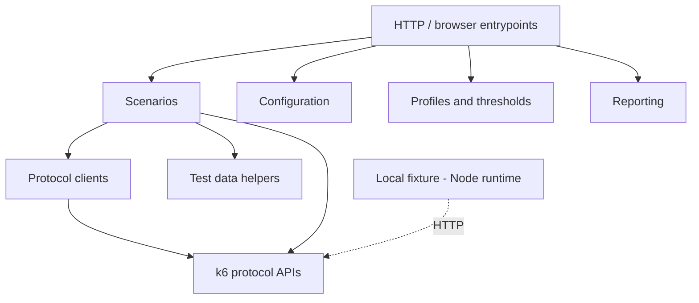

# Architecture

Requirement: FR-004 (#4). Status: proposed design; runtime implementation pending.

## Dependency direction

The fixture is a separate process: k6 clients send requests to it, not the reverse. Node tooling never enters the k6 import graph.

## Directory contracts

| Path | Responsibility | Runtime |
|---|---|---|
| examples/http/ | HTTP entrypoints exporting options and scenario functions | k6 |
| examples/browser/ | Browser entrypoints and journeys | k6 |
| src/config/ | Pure parsing, validation, typed configuration | shared / k6 |
| src/clients/ | Protocol requests and response handling | k6 |
| src/scenarios/ | Reusable workflow functions | k6 |
| src/data/ | Deterministic data helpers | shared / k6 |
| src/profiles/ | Workload options | k6-compatible |
| src/thresholds/ | Threshold definitions | k6-compatible |
| src/reporting/ | Sanitized summary mapping | k6-compatible |
| fixtures/ | Local test application | Node |
| tests/unit/ | Pure helper contracts | Node |
| tests/integration/ | Real k6 process and fixture verification | Node orchestration |
| docs/ | Architecture, decisions and onboarding | none |

## Lifecycle
Init: parse configuration, declare options, import helpers; no network traffic. Setup: optional shared serializable data. VU iteration: execute workflow, check response, emit metrics. Teardown: best-effort cleanup; abrupt termination may bypass it. Summary: serialize available results without replacing exit status.

## Design rules
Entrypoints assemble options and workflows; scenario modules do not own environment selection. Clients accept explicit base URL and request parameters. No mutable cross-VU state. Shared helpers avoid k6 and Node imports where possible. Avoid barrel exports that introduce runtime-incompatible modules. Browser and telemetry are isolated and optional.

## Verification
Two HTTP examples must share at least one client/helper without duplication; actual k6 smoke and TypeScript checks must pass from a clean checkout. These remain pending #9, #2 and #1. No empty placeholder directories are needed before implementation.
